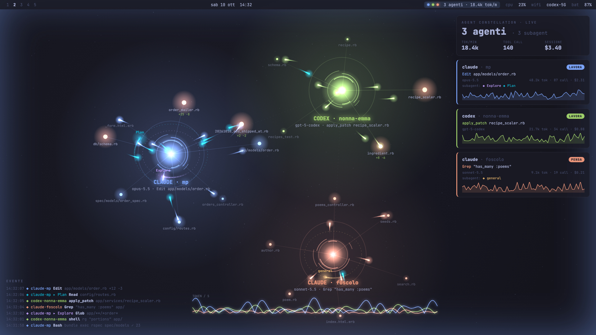
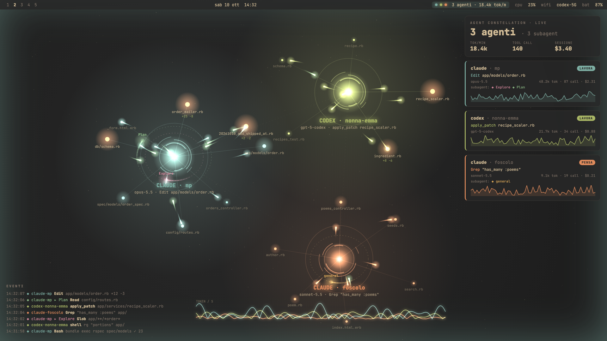
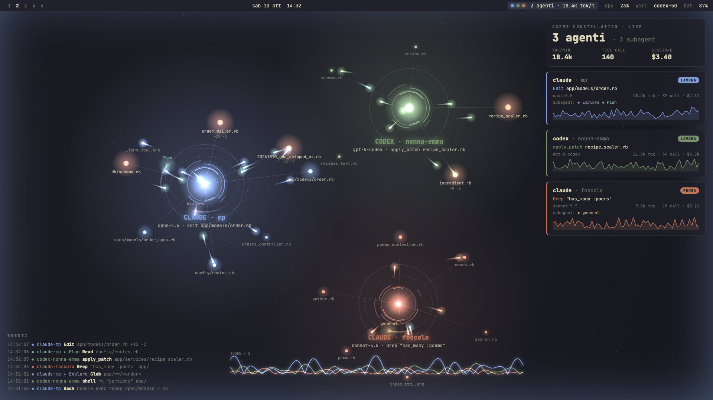
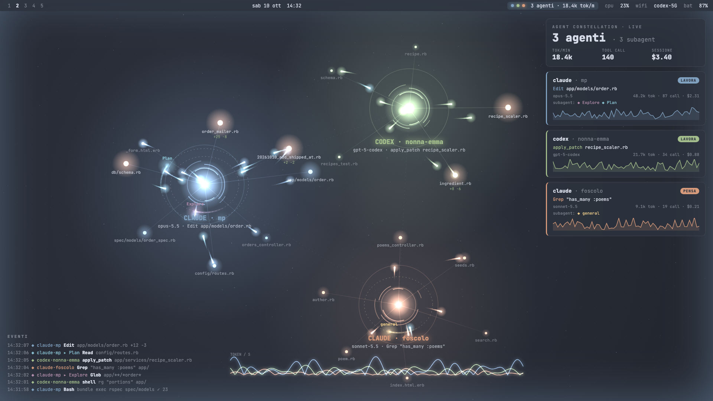
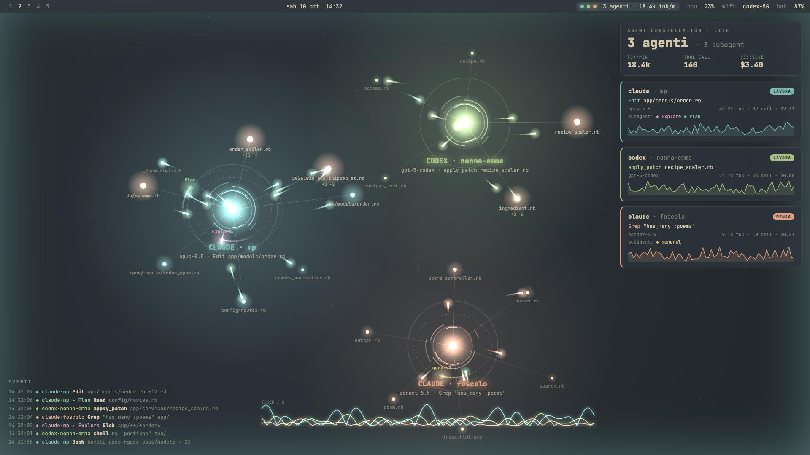
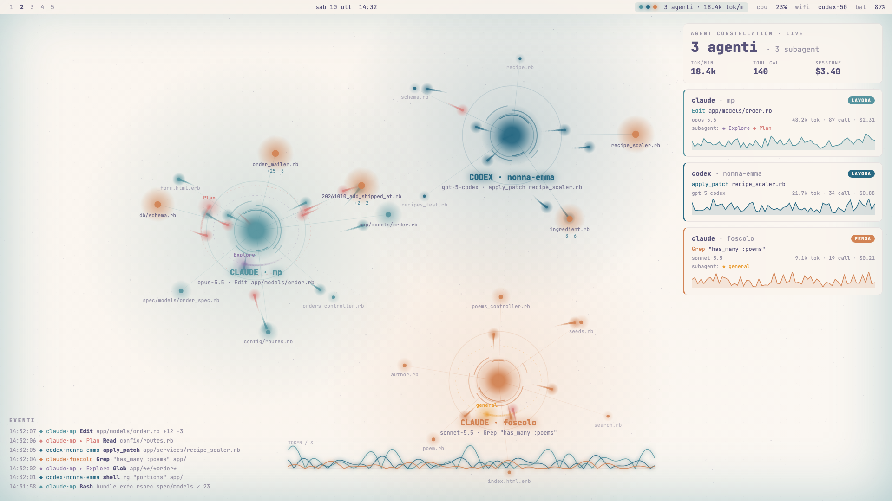
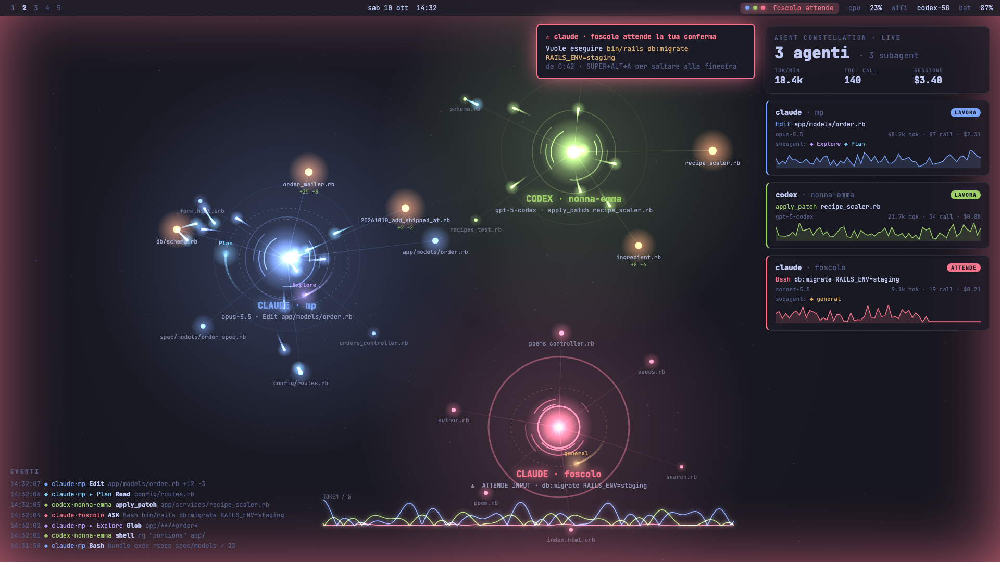

# agent-constellation

A live, theme-aware visualizer for the AI coding agents running on your [Omarchy](https://omarchy.org) desktop.

Every agent is a glowing core. Its subagents orbit around it, each tool call flies out to the file it touches, and the files touched most often heat up. When an agent is waiting for your input, its core turns red and pulses, and the screen edges glow.


> **Status: prototype.** The visuals are done, but the agent activity is still **simulated**. Wiring it to real Claude Code hooks and Codex session logs is the next step (see [Roadmap](#roadmap)).

## Follows your Omarchy theme

The palette is read from `~/.config/omarchy/current/theme/alacritty.toml`, which every Omarchy theme ships. `omarchy-theme-set` swaps that symlink, the page re-reads it every 2 seconds, and the colors change live without a reload. Light themes are supported: additive glow is switched off on light backgrounds.

| Tokyo Night | Gruvbox | Kanagawa |
|---|---|---|
|  |  |  |
| **Nord** | **Everforest** | **Rosé Pine (light)** |
|  |  |  |

When an agent needs you:



## Try it

```bash
git clone https://github.com/simoz/agent-constellation.git
cd agent-constellation
bin/constellation-serve        # http://localhost:7777
```

`constellation-serve` symlinks `web/theme` to your active Omarchy theme and serves the page on localhost. If you're not on Omarchy it falls back to Tokyo Night, and you can pick a built-in palette with `?theme=gruvbox|catppuccin|kanagawa|nord|everforest|rose-pine`.

Other URL options: `?scene=wait` (an agent waiting for input), `?scene=tiles` (as a background behind tiled windows).

## Roadmap

- [ ] `constellationd`: collect real events from Claude Code hooks (`SessionStart`, `PreToolUse`, `PostToolUse`, `SubagentStop`, `Notification`, `Stop`) and Codex session logs, and stream them over a local WebSocket
- [ ] `constellation install-hooks`: add the hooks to `~/.claude/settings.json`
- [ ] Background mode: a layer-shell surface on Hyprland's background layer, shown only on the workspaces you choose (driven by Hyprland's IPC socket)
- [ ] Dashboard mode: full screen on a dedicated workspace, toggled with `SUPER+ALT+A`
- [ ] Waybar module `custom/constellation` and a Mako notification when an agent is waiting for you
- [ ] Omarchy-style install script

## License

MIT
