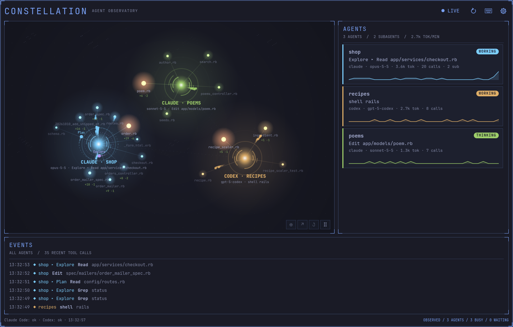
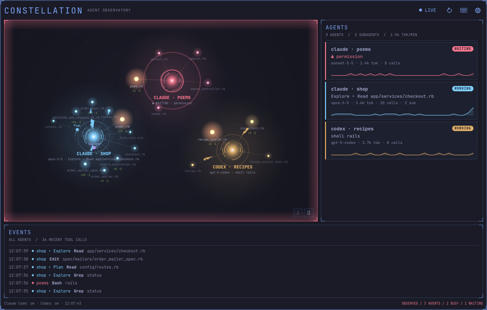
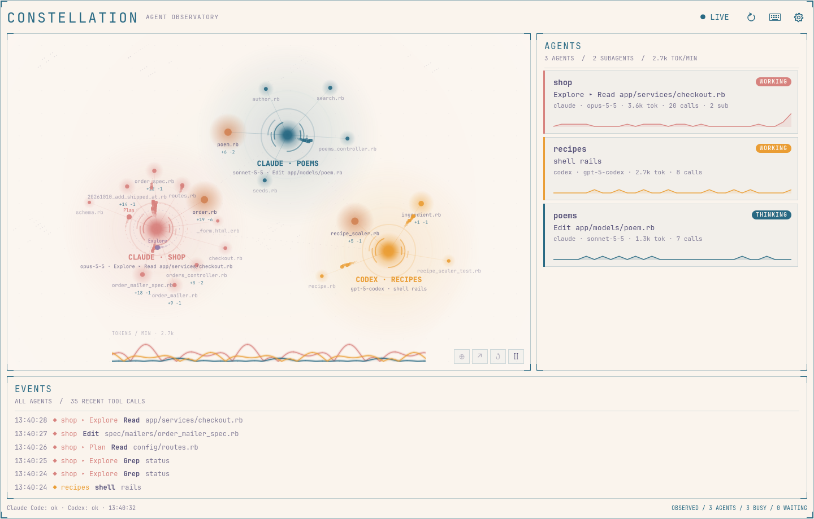

# Agent Constellation

Watch your coding agents work.

Agent Constellation is an Omarchy plugin that shows the Claude Code and Codex
sessions running on your machine as a live constellation. Every agent is a
glowing core. Its subagents orbit around it, each tool call flies out to the
file it touches, and the files touched most often heat up. When an agent is
waiting for your input, its core turns red and pulses, and the bar icon turns
red too.



## Features

- Bar icon with one dot per agent; red when an agent needs you.
- Compact panel and expanded window sharing the same view.
- Agent cards with status, current tool call, model, tokens and a five-minute
  activity sparkline.
- Event log of recent tool calls, filtered to the selected agent.
- Colors from the active Omarchy theme, light and dark; keyboard controls.

| Waiting for input | Light theme |
| --- | --- |
|  |  |

Screenshots use the fictional sessions in `demo/fixtures.py`.

## Requirements

- The Omarchy Quattro built-in bar with Quickshell.
- Python 3.11+ (part of Omarchy).
- Claude Code and/or Codex running locally.

## Install

```bash
omarchy plugin add https://github.com/simoz/agent-constellation.git --enable
```

Nothing else is installed and no agent settings or hooks are changed. See
[development](docs/development.md#install-the-plugin) to install from a working
copy.

## Uninstall

```bash
omarchy plugin remove io.github.simoz.agent-constellation
```

## Using Agent Constellation

Left-click the bar icon to toggle the compact panel. Right-click it to open the
expanded window directly, or bring it into focus if it is already open.

While the icon is in the bar, sessions are checked every 5 seconds so a waiting
agent can turn it red. An open panel or window refreshes at the configured
interval (1 second by default). Use **LIVE / PAUSED** in the header to pause or
resume collection; pause survives closing and reopening the view. Use
**Refresh** (⟳) to collect once; while paused it stays paused.

Click an agent core or card to highlight it and filter the event list; click it
again, or press **↺**, to show all agents. **Ⅱ / ▷** pauses the animation without
stopping collection. The arrow button switches between compact panel and
expanded window, preserving the selection.

Open settings with the gear button:

- **Sources**: read Claude Code and/or Codex sessions, and their directories
  (defaults: `$CLAUDE_CONFIG_DIR` or `~/.claude`, `$CODEX_HOME` or `~/.codex`).
- **Collection**: refresh interval, how long idle sessions stay visible, pause
  and retry.
- **About**: what is read and shown.

**Done** saves the changes. Invalid values keep the editor open. **Esc** or
clicking outside closes without saving.

### Keyboard controls

These shortcuts work inside Agent Constellation while Settings and KEYS are
closed. They do not register desktop bindings or use Super. When a text field
has focus, editing keys take priority.

| Shortcut | Action |
| --- | --- |
| Ctrl+R | Refresh once, preserving manual pause |
| Ctrl+P | Pause / resume collection |
| Ctrl+E | Switch compact panel / expanded window |
| Ctrl+, | Open Settings |
| Ctrl+G | Pause / resume the animation |
| Ctrl+Shift+R | Show all agents again |

The keyboard button or **F1** opens the KEYS guide. F1 is inactive while
Settings is open.

| Focus / context | Keys | Action |
| --- | --- | --- |
| Controls | Tab / Shift+Tab | Move to the next / previous control |
| Button or agent card | Enter / Space | Activate the button, or highlight the agent |
| Constellation | ← / ↑ / → / ↓ | Select the previous / next agent |
| Constellation | Home | Show all agents again |
| Agent list | ↑ / ↓ | Move between cards |
| Event list | ↑ / ↓ / PgUp / PgDn | Scroll |
| KEYS guide | ↑ / ↓ / PgUp / PgDn | Scroll the guide |
| Dashboard / KEYS guide | F1 | Open / close the guide |
| Settings or guide | Esc | Close that popup |
| Dashboard | Esc | Close Agent Constellation |

## What the data means

The collector reads, without changing them, Claude Code session records and
transcripts and Codex rollout files. It shows tool names, file paths relative
to each project, program names without arguments, search patterns, token
counts and status. A search pattern that names or looks like a credential (for
example `password`, `API_KEY` or a long mixed token) is shown as `[redacted]`.
Prompts, replies, command arguments and tool output are never displayed or
stored, and nothing is sent over the network.

**Waiting** comes from Claude Code's own session records. Codex does not record
approval prompts in its session files, so Codex agents show working, thinking
or idle only. Codex sessions are shown only while a Codex process runs, and
Codex subagents such as the approval guardian appear under their parent
session. **Thinking** means the agent is busy without a tool call in the last
20 seconds. Heat is relative to each agent's hottest file and fades with a
five-minute half-life; files untouched for 15 minutes are hidden. Files outside
the project and the home folder show only their name, as `…/name`. The first
time a long session is seen, only the last 1 MiB of its transcript is read.

## Development and licenses

- [Development and tests](docs/development.md)
- [Architecture and design record](docs/architecture.md)
- [Collector protocol](docs/protocol.md)

MIT.
